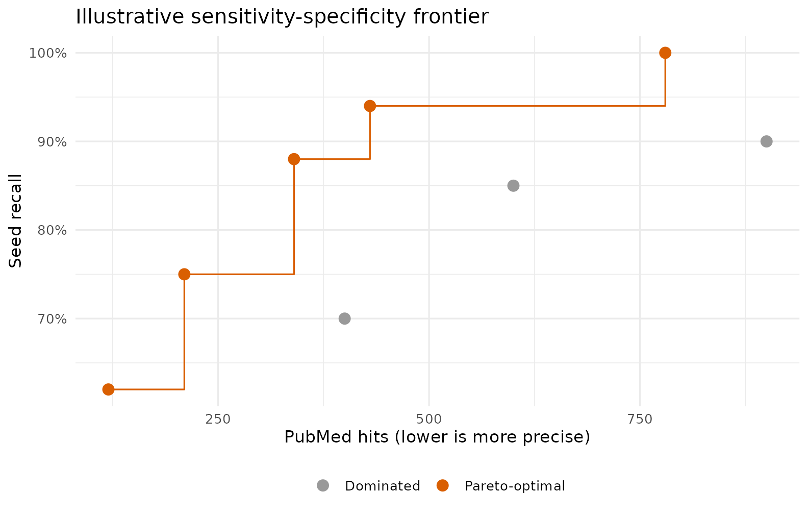

# How revlitquery Works: The Workflow Step by Step

## Overview

`revlitquery` performs a **reverse literature search**: you give it a
handful of papers you already know are relevant (the *seed corpus*), and
it reverse-engineers a boolean query for **PubMed** and **Google
Scholar** (at most 256 characters) that finds those papers and as few
irrelevant ones as possible.

Nothing about the topic is hardcoded. Concepts, synonyms, wildcards and
exclusions are all discovered from the text of the seed papers and of
the non-seed papers a draft query returns.

The figure below summarises the eight steps. The rest of this vignette
explains each one and runs a small, fully offline example on a synthetic
corpus (no network access needed).


The whole pipeline is wrapped by
[`optimize_search_queries()`](https://pascalcrepey.github.io/revlitquery/reference/optimize_search_queries.md);
every step is also exported so you can run, inspect, or replace it
individually.

## A synthetic seed corpus

To keep the example offline, we build the seed table by hand. In real
use, steps 1 and 2 produce exactly this structure from your BibTeX file.

``` r

titles <- c(
  "Pollinator decline in fragmented agricultural landscapes",
  "Wild bee pollinator richness decline across fragmented farmland",
  "Bumblebee abundance loss in fragmented agricultural habitats",
  "Pollinator diversity loss in fragmented agroecosystem landscapes",
  "Solitary bee decline across fragmented cropland habitats",
  "Pollinator richness loss in fragmented agricultural ecosystems",
  "Pesticide exposure drives pollinator decline in farmland",
  "Hoverfly pollinator abundance decline in fragmented meadows"
)
seeds <- tibble::tibble(
  seed_id = seq_along(titles),
  citekey = paste0("seed", seq_along(titles)),
  year = as.character(2016 + seq_along(titles)),
  doi = "",
  pmid = as.character(1000 + seq_along(titles)),
  in_pubmed = TRUE,
  full_title = titles,
  full_abstract = titles,
  full_text = titles,
  mesh_terms = rep(list(character(0)), length(titles)),
  all_keywords = rep(list(character(0)), length(titles))
)
seeds[, c("citekey", "full_title")]
#> # A tibble: 8 × 2
#>   citekey full_title                                                      
#>   <chr>   <chr>                                                           
#> 1 seed1   Pollinator decline in fragmented agricultural landscapes        
#> 2 seed2   Wild bee pollinator richness decline across fragmented farmland 
#> 3 seed3   Bumblebee abundance loss in fragmented agricultural habitats    
#> 4 seed4   Pollinator diversity loss in fragmented agroecosystem landscapes
#> 5 seed5   Solitary bee decline across fragmented cropland habitats        
#> 6 seed6   Pollinator richness loss in fragmented agricultural ecosystems  
#> 7 seed7   Pesticide exposure drives pollinator decline in farmland        
#> 8 seed8   Hoverfly pollinator abundance decline in fragmented meadows
```

## Step 1: Parse the seed BibTeX file

[`parse_bibtex()`](https://pascalcrepey.github.io/revlitquery/reference/parse_bibtex.md)
reads a `.bib` file, cleans LaTeX markup, and extracts titles,
abstracts, DOIs, PMIDs and keywords. It tolerates concatenated strings,
nested braces and malformed entries.

``` r

seeds_raw <- parse_bibtex("path/to/seed_articles.bib")
```

## Step 2: Enrich seeds with PubMed

[`enrich_seeds()`](https://pascalcrepey.github.io/revlitquery/reference/enrich_seeds.md)
resolves each reference to a PubMed record by PMID, then DOI, then fuzzy
title match
([`title_jaccard()`](https://pascalcrepey.github.io/revlitquery/reference/title_jaccard.md)).
It adds PubMed abstracts, MeSH headings and author keywords, and flags
seeds that are not in PubMed (`in_pubmed = FALSE`). Calls follow the
NCBI usage policy (identified tool name, HTTP POST, rate limiting) and
are cached on disk.

``` r

seeds <- enrich_seeds(seeds_raw, cache_dir = ".cache")
```

## Step 3: Extract and score candidate terms

[`extract_candidate_terms()`](https://pascalcrepey.github.io/revlitquery/reference/extract_candidate_terms.md)
mines 1- to 3-grams from titles and abstracts and **synthesizes prefix
wildcards** (for example `decreas*`, `pollinat*`) when several corpus
words share a stem that rescues extra seeds. A multi-layer set-cover
shortlist keeps terms from several independent facets of the corpus,
plus rare terms that rescue outlier papers. Each shortlisted term is
probed in PubMed for its background frequency, giving a **lift** (how
over-represented the term is in your seeds compared to PubMed overall).

Here a function replaces the live PubMed probe:

``` r

fake_bg <- function(term) {
  switch(term,
    "pollinator" = 9000L, "decline" = 120000L, "fragmented" = 15000L,
    40000L
  )
}
terms <- extract_candidate_terms(seeds, probe_pubmed = TRUE, eval_bg_fn = fake_bg)
head(terms[, c("term", "df_tiab", "bg_hits", "lift")], 8)
#> # A tibble: 8 × 4
#>   term                      df_tiab bg_hits  lift
#>   <chr>                       <int>   <int> <dbl>
#> 1 fragmented                      7   15000 2217.
#> 2 pollinator                      6    9000 3166.
#> 3 decline                         5  120000  198.
#> 4 fragmented agricultural         3   40000  356.
#> 5 agricultural                    3   40000  356.
#> 6 loss                            3   40000  356.
#> 7 decline across fragmented       2   40000  237.
#> 8 pollinator decline              2   40000  237.
```

## Step 4: Discover concept blocks

Instead of a predefined concept list,
[`build_concept_blocks()`](https://pascalcrepey.github.io/revlitquery/reference/build_concept_blocks.md)
discovers the structure of the topic from the data:

1.  The best high-lift anchor becomes the **primary topic** block.
2.  [`discover_term_clusters()`](https://pascalcrepey.github.io/revlitquery/reference/discover_term_clusters.md)
    builds a graph of candidate terms. Edges combine local-context and
    MeSH/keyword similarity (a small latent semantic analysis), coverage
    complementarity (two terms that cover different seeds are likely
    interchangeable `OR` synonyms), and lexical similarity. Louvain
    community detection then groups terms into concepts.
3.  Within each community a greedy set-cover grows an `OR` block; blocks
    are combined with `AND`.

``` r

blocks <- build_concept_blocks(
  terms, seeds,
  max_blocks = 3L,
  probe_selectivity = TRUE,
  eval_joint_fn = function(t1, t2) 2500L   # stand-in for a PubMed joint count
)
for (b in blocks) cat(sprintf("%-22s %s\n", b$name, paste(b$terms, collapse = " | ")))
#> primary_topic          fragmented | pollinator
#> concept_decline        decline
#> concept_agricultural   agricultural | loss | abundance | richness
```

You can always override discovery with `custom_blocks` in the
configuration.

## Step 5: Build and translate candidate queries

[`generate_initial_candidates()`](https://pascalcrepey.github.io/revlitquery/reference/generate_initial_candidates.md)
combines block specificity tiers and fields (title vs. title/abstract)
into diverse candidates, discarding any that exceed 256 characters once
translated. A query is a canonical object that
[`to_pubmed_query()`](https://pascalcrepey.github.io/revlitquery/reference/to_pubmed_query.md)
and
[`to_google_scholar_query()`](https://pascalcrepey.github.io/revlitquery/reference/to_google_scholar_query.md)
translate into each syntax (Google Scholar has no truncation operator,
so wildcards are expanded to the dominant corpus word or a morphological
stem).

``` r

q <- make_query(list(
  list(name = "topic",   field = "tiab", terms = c("pollinat*", "bee")),
  list(name = "trend",   field = "tiab", terms = c("decline", "loss"))
), exclude_terms = "pesticide")

cat(to_pubmed_query(q), "\n")
#> (("pollinat*"[tiab] OR "bee"[tiab]) AND ("decline"[tiab] OR "loss"[tiab])) NOT ("pesticide"[tiab])
cat(to_google_scholar_query(q), "\n")
#> (pollinat OR bee) (decline OR loss) -pesticide
gs_char_count(q)
#> [1] 46
```

Without network access,
[`estimate_local_query()`](https://pascalcrepey.github.io/revlitquery/reference/estimate_local_query.md)
scores a query against the seed texts, which is what the optimizer uses
to pre-rank candidates before spending PubMed calls.

``` r

est <- estimate_local_query(q, terms, seeds)
c(local_recall = est$local_recall, seeds_found = est$local_found)
#> local_recall  seeds_found 
#>         0.75         6.00
```

## Step 6: Mine exclusion hints

[`discover_exclusion_hints()`](https://pascalcrepey.github.io/revlitquery/reference/discover_exclusion_hints.md)
samples non-seed articles returned by the best draft query and finds
what makes them noise. Candidate `NOT` terms (words, phrases, and
synthesized wildcards) are checked locally against the seeds so none
that would drop a seed is recommended blindly. Terms are then
partitioned into **noise topics** by an NPMI/Jaccard co-occurrence graph
with Louvain clustering
([`cluster_exclusion_terms()`](https://pascalcrepey.github.io/revlitquery/reference/cluster_exclusion_terms.md)),
and a greedy set-cover builds compact exclusion bundles that fit in the
256-character budget. Verified hit reductions come from live PubMed
counts.

``` r

noise_terms <- c("xenograft", "mice", "vitro", "resection", "laparoscopic", "biopsy")
noise_cov <- list(
  c(rep(TRUE, 6), rep(FALSE, 6)), c(rep(TRUE, 5), rep(FALSE, 7)),
  c(FALSE, rep(TRUE, 5), rep(FALSE, 6)), c(rep(FALSE, 6), rep(TRUE, 6)),
  c(rep(FALSE, 6), rep(TRUE, 5), FALSE), c(rep(FALSE, 7), rep(TRUE, 5))
)
as.character(cluster_exclusion_terms(noise_terms, noise_cov))
#> [1] "topic_xenograft_mice"         "topic_xenograft_mice"        
#> [3] "topic_xenograft_mice"         "topic_resection_laparoscopic"
#> [5] "topic_resection_laparoscopic" "topic_resection_laparoscopic"
```

## Step 7: Refine neighbours

[`optimize_queries()`](https://pascalcrepey.github.io/revlitquery/reference/optimize_queries.md)
runs a two-stage search under a fixed evaluation budget (`max_evals`).
**Stage 1** evaluates the initial candidates live. **Stage 2a** adds
exclusion-refined variants. **Stage 2b** greedily generates neighbours
of the current Pareto queries: prune a term, switch a field, swap in a
narrower variant, add a rescue term from the same concept cluster for
seeds still missed, add a qualifier block, or extend the exclusions.
Each round re-evaluates the most promising neighbours and stops once the
frontier stops improving.

## Step 8: Read the Pareto frontier

Every evaluated query has a recall (share of seeds found) and a hit
count (PubMed results). The **Pareto frontier** keeps queries that no
other query beats on both axes.
[`write_optimization_report()`](https://pascalcrepey.github.io/revlitquery/reference/write_optimization_report.md)
exports it with PubMed and Google Scholar strings and links; the Shiny
app
([`run_revlitquery_app()`](https://pascalcrepey.github.io/revlitquery/reference/run_revlitquery_app.md))
shows it interactively.

``` r

frontier_demo <- data.frame(
  recall = c(0.62, 0.75, 0.88, 0.94, 1.00, 0.70, 0.90, 0.85),
  hits   = c(120, 210, 340, 430, 780, 400, 900, 600)
)
frontier_demo$is_pareto <- compute_pareto_frontier(
  data.frame(combined_recall = frontier_demo$recall, pm_hits = frontier_demo$hits,
             gs_chars = 100L, n_terms = 4L)
)
ggplot(frontier_demo, aes(hits, recall)) +
  geom_step(data = subset(frontier_demo, is_pareto), direction = "hv",
            colour = "#d95f02") +
  geom_point(aes(colour = is_pareto), size = 3) +
  scale_colour_manual(values = c(`TRUE` = "#d95f02", `FALSE` = "grey60"),
                      labels = c("Dominated", "Pareto-optimal"), name = NULL) +
  scale_y_continuous(labels = scales::percent) +
  labs(x = "PubMed hits (lower is more precise)", y = "Seed recall",
       title = "Illustrative sensitivity-specificity frontier") +
  theme_minimal(base_size = 11) +
  theme(legend.position = "bottom")
```



Pick the point on the frontier that matches your review: a high-recall
query for systematic reviews, or a compact query for quick scoping.

## Putting it together

All eight steps run in one call:

``` r

res <- optimize_search_queries(
  bib_path   = "path/to/seed_articles.bib",
  output_dir = "output",
  min_recall = 0.90,
  max_hits   = 1000
)
res$pareto_df
```

See
[`vignette("cli-and-r-workflow")`](https://pascalcrepey.github.io/revlitquery/articles/cli-and-r-workflow.md)
for command-line options and
[`vignette("shiny-interface")`](https://pascalcrepey.github.io/revlitquery/articles/shiny-interface.md)
for the interactive dashboard.
