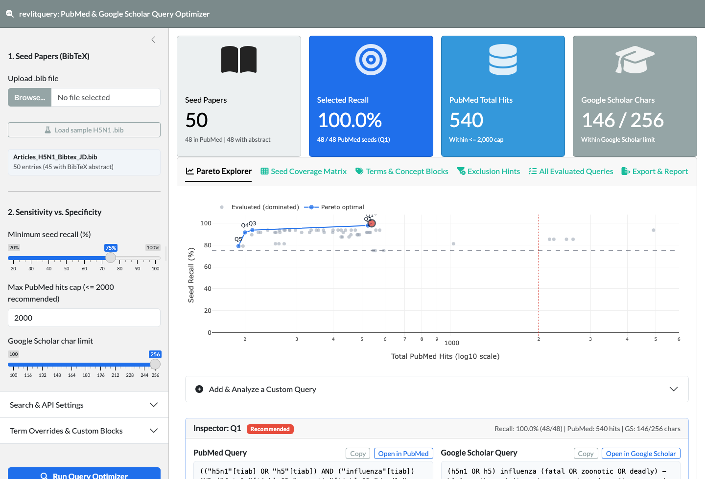
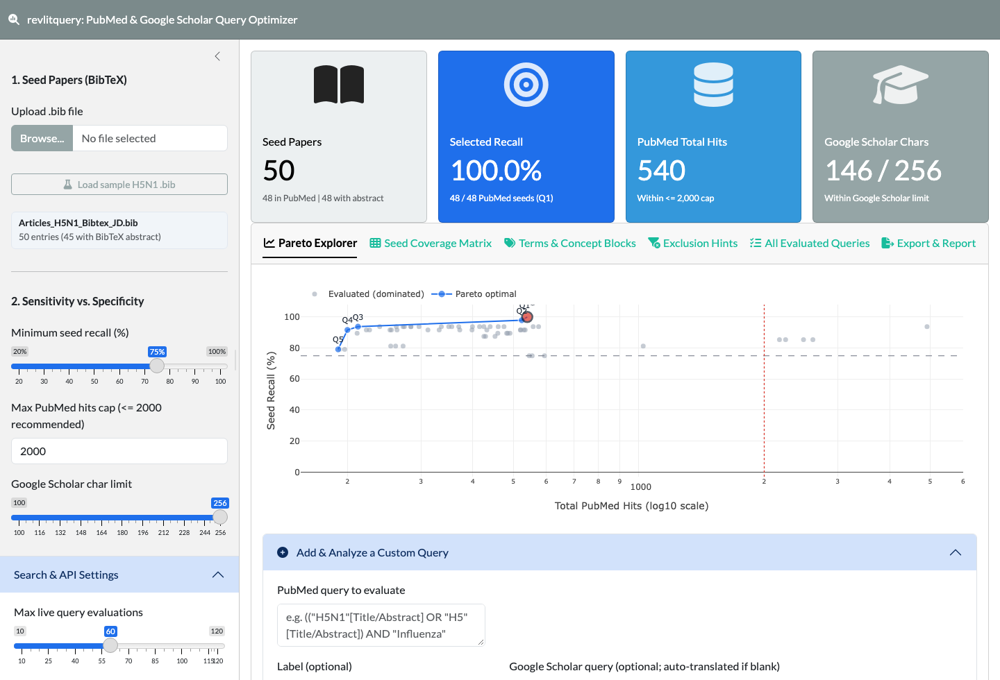
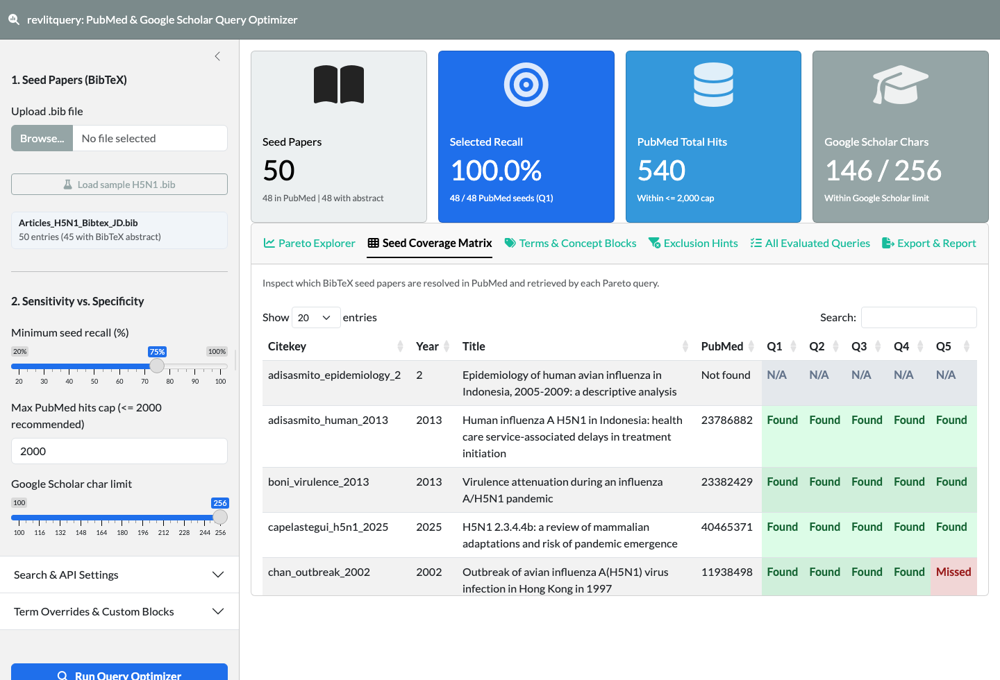
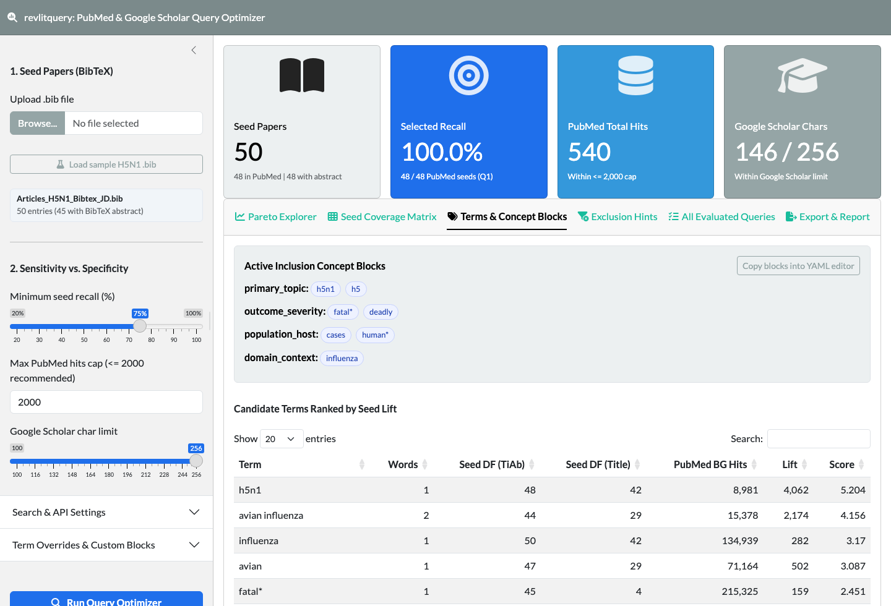
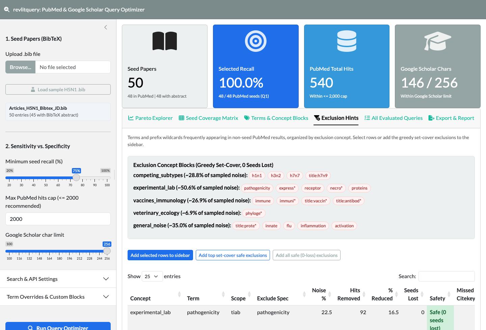
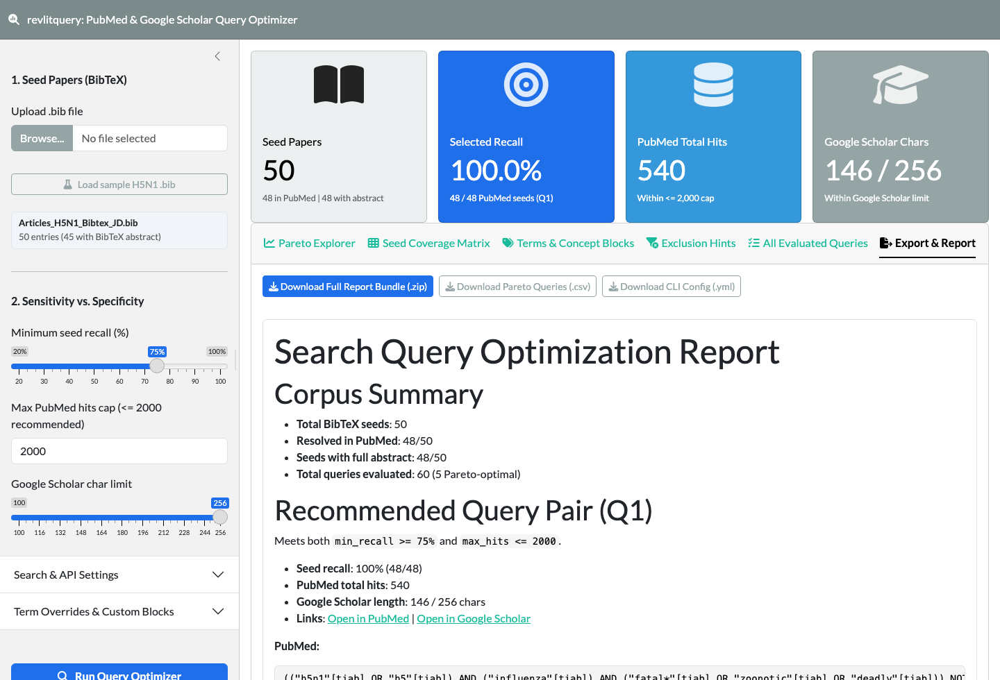

```{r, include = FALSE}
knitr::opts_chunk$set(
  collapse = TRUE,
  comment = "#>",
  out.width = "100%"
)
```

## Overview

`revlitquery` includes an interactive **Shiny dashboard** built with `bslib`, `plotly`, and `DT` to pilot the reverse literature review search query optimizer. The dashboard allows you to:

1. **Upload any `.bib` seed corpus** (or load the built-in H5N1 demo dataset).
2. **Tune sensitivity vs. specificity targets** (`Minimum seed recall (%)`, `Max PubMed hits cap`, and `Google Scholar char limit`).
3. **Explore the live Pareto frontier** comparing total PubMed hit volume (log scale) against seed recall (%).
4. **Benchmark your own custom PubMed/Google Scholar queries** alongside automatically discovered queries.
5. **Inspect paper-by-paper coverage** across all Pareto-optimal and custom queries.
6. **Review unsupervised inclusion concept blocks and noise-topic exclusion clusters** with one-click addition to your query exclusions.
7. **Export a reproducible report bundle** (`.zip`, `.csv`, and CLI `.yml` config).

---

## Launching the Shiny Application

From an interactive R session:

```{r, eval = FALSE}
library(revlitquery)

# Launch a fresh interactive session
run_revlitquery_app()
```

If you have already run `optimize_search_queries()` in R, you can also open the dashboard pre-populated with your optimization results:

```{r, eval = FALSE}
res <- optimize_search_queries(
  bib_path   = "path/to/seed_articles.bib",
  output_dir = "output",
  min_recall = 0.90,
  max_hits   = 1000
)

run_revlitquery_app(
  initial_result    = res,
  initial_bib_label = "seed_articles.bib"
)
```

---

## Step-by-Step Walkthrough of the Interface

### 1. Pareto Explorer & Query Inspector

When the application opens (and after clicking **Run Query Optimizer** in the left sidebar), the **Pareto Explorer** tab displays:

- **Left Sidebar**:
  - **1. Seed Papers (BibTeX)**: Upload a `.bib` file or click **Load sample H5N1 .bib**. A status pill shows the number of loaded entries and how many contain abstracts.
  - **2. Sensitivity vs. Specificity**: Adjust the target **Minimum seed recall (%)** (e.g., `75%` or `90%`), **Max PubMed hits cap** (default `2000`, or `1000` for tighter specificity), and **Google Scholar char limit** (`<= 256`). Moving the recall slider or changing the hit cap dynamically updates the recommended query and plot threshold lines without re-querying PubMed.
- **Top Value Boxes**: Summarize total seed papers (and how many resolved in PubMed with abstracts), the currently selected query's seed recall (`100.0%`, `48 / 48 PubMed seeds`), total PubMed hits (`540`, within the `<= 1,000` cap), and Google Scholar character count (`146 / 256`).
- **Interactive Pareto Frontier Plot**: Plots every evaluated query by **PubMed Total Hits (log scale)** on the x-axis and **Seed Recall (%)** on the y-axis:
  - **Red star**: The recommended Pareto-optimal query meeting both your minimum recall and maximum hit cap.
  - **Blue circles**: All non-dominated Pareto frontier queries (`Q1`, `Q2`, ...).
  - **Gray circles**: Dominated candidate queries evaluated during Stage 1 and Stage 2 search.
  - Clicking any point on the plot (or any row in the Pareto table below) loads that query into the **Selected Query Inspector** card.
- **Selected Query Inspector Card**: Displays side-by-side **PubMed Query** and **Google Scholar Query** boxes with one-click **Copy** buttons, **Open in PubMed** / **Open in Google Scholar** verification links, and the list of any missed seed citekeys.

```{r, echo = FALSE, fig.cap = "Figure 1: The Pareto Explorer tab showing the sensitivity-specificity Pareto frontier, summary value boxes, and Selected Query Inspector card (100% seed recall in 540 PubMed hits)."}

```

---

### 2. Custom Query Benchmarking & Sidebar Term Overrides

Expanding the accordions in the sidebar and main panel reveals advanced controls:

- **Search & API Settings** *(sidebar)*: Control `Max live query evaluations`, `Max concept blocks` (`1..4`), `Max terms per block`, disk caching (`.cache/`), and optional `NCBI_EMAIL` / `NCBI_API_KEY` credentials.
- **Term Overrides & Custom Blocks** *(sidebar)*:
  - **Required terms**: Force specific terms (e.g., `h5n1`) to appear in the primary concept block.
  - **Banned candidate terms**: Exclude generic phrases from candidate extraction.
  - **Exclude terms (`NOT` / `-`)**: Add explicit exclusion terms, prefix wildcards (e.g., `vaccin*`), or title-scoped exclusions (e.g., `title:ferret*`).
  - **Custom concept blocks (YAML)**: Manually edit or paste concept blocks in YAML format, or click **Copy discovered blocks into editor** to fine-tune the automatically discovered PICO blocks.
- **Add & Analyze a Custom Query** *(main panel)*: Paste any existing PubMed boolean query (such as a manual search strategy from a published systematic review), optionally assign a label (e.g., `"Manuscript original"`), and click **Evaluate & Add Query**. The app evaluates its live PubMed hit count and exact seed recall, auto-translates it into Google Scholar syntax, and plots it directly on the Pareto chart (as a purple diamond).

```{r, echo = FALSE, fig.cap = "Figure 2: Expanded 'Term Overrides & Custom Blocks' sidebar panel and 'Add & Analyze a Custom Query' benchmarking drawer."}

```

---

### 3. Seed Coverage Matrix

The **Seed Coverage Matrix** tab shows a paper-by-paper breakdown of your BibTeX corpus across every Pareto-optimal query (`Q1`, `Q2`, ...) and any custom benchmark queries:

- **PubMed column**: Links directly to each resolved article's PMID on PubMed (or indicates `Not in PM` for gray literature / non-indexed reports).
- **Query columns (`Q1`, `Q2`, ...)**: Color-coded cells indicate whether each seed paper is **Found** (green), **Missed** (red), or **N/A** (gray, not indexed in PubMed). This makes it easy to identify outlier seed papers that require an additional synonym in a concept block.

```{r, echo = FALSE, fig.cap = "Figure 3: The Seed Coverage Matrix tab displaying per-article retrieval status across Pareto-optimal queries Q1-Q5."}

```

---

### 4. Terms & Concept Blocks

The **Terms & Concept Blocks** tab exposes the internal vocabulary discovery stage:

- **Active Inclusion Concept Blocks**: Displays the automatically discovered orthogonal concept blocks (discovered via distributional SVD context, MeSH/keyword co-assignment, and Louvain graph set-cover) as pill badges, with a button to copy them into the YAML editor for manual editing.
- **Candidate Terms Ranked by Seed Lift**: Lists every extracted unigram, bigram, trigram, and synthesized prefix wildcard (`*`) along with its seed document frequency in Title/Abstract (`Seed DF (TiAb)`), Title document frequency (`Seed DF (Title)`), live PubMed background hit count (`PubMed BG Hits`), specificity lift (`Lift`), and composite score (`Score`).

```{r, echo = FALSE, fig.cap = "Figure 4: The Terms & Concept Blocks tab showing active inclusion concept blocks and candidate terms ranked by seed lift over PubMed background frequency."}

```

---

### 5. Concept-Grouped Exclusion Hints

When a query retrieves too many irrelevant PubMed hits, `revlitquery` performs timeline-stratified sampling of non-seed PubMed articles retrieved by your query, synthesizes prefix wildcards (`*`) and `title:`-scoped exclusions, verifies exact hit reductions against PubMed, and organizes candidate exclusions into scientific concepts:

- **Exclusion Concept Blocks (Greedy Set-Cover, 0 Seeds Lost)**: Summarizes the top zero-loss exclusion terms grouped into unsupervised noise topics (discovered via Normalized Pointwise Mutual Information co-occurrence clustering on sampled non-seed articles) and reports the percentage of sampled non-seed noise covered by each block.
- **Quick-Add Action Buttons**:
  - **Add selected rows to sidebar**: Appends any rows you highlight in the table to the sidebar's `Exclude terms (NOT / -)` box.
  - **Add top set-cover safe exclusions**: Appends the greedy set-cover exclusion set (maximizing orthogonal noise removal with `0` seed loss).
  - **Add all safe (0-loss) exclusions**: Appends all verified zero-loss exclusion terms.
- **Exclusion Hints Table**: Displays up to 35 ranked exclusion candidates with their concept category, scope (`tiab` vs. `title`), noise frequency (`Noise %`), verified PubMed hits removed (`Hits Removed` and `% Reduced`), `Seeds Lost` count, safety badge (`Safe (0 seeds lost)`), and exact PubMed (`NOT ...`) and Google Scholar (`-...` / `-intitle:...`) clauses.

```{r, echo = FALSE, fig.cap = "Figure 5: The Exclusion Hints tab showing greedy set-cover exclusion concept blocks and verified hit reductions."}

```

---

### 6. Export & Report

The **Export & Report** tab provides one-click downloads and an inline preview of the generated Markdown report:

- **Download Full Report Bundle (`.zip`)**: Contains `report.md`, `pareto_queries.csv`, `all_evaluated_queries.csv`, `seed_resolution.csv`, `seed_coverage_matrix.csv`, `exclusion_hints.csv`, and `pareto_frontier.png`.
- **Download Pareto Queries (`.csv`)**: Spreadsheet of the non-dominated PubMed and Google Scholar query pairs and verification URLs.
- **Download CLI Config (`.yml`)**: Exports your current sidebar settings, required/banned/exclude terms, and custom concept blocks as a YAML configuration file ready for `Rscript run_query_optimizer.R --bib seeds.bib --config optimizer_config.yml`.

```{r, echo = FALSE, fig.cap = "Figure 6: The Export & Report tab with one-click bundle downloads and live Markdown report preview."}

```
